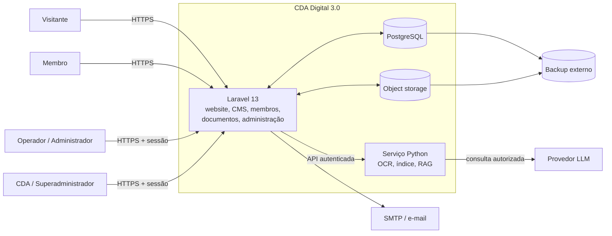
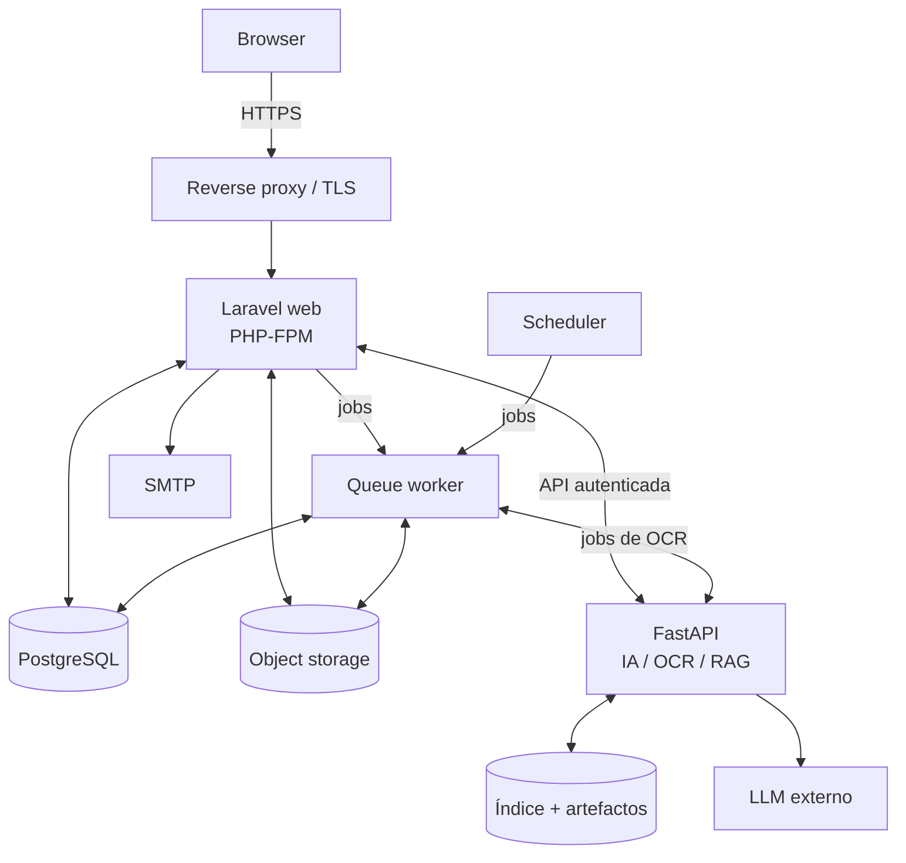
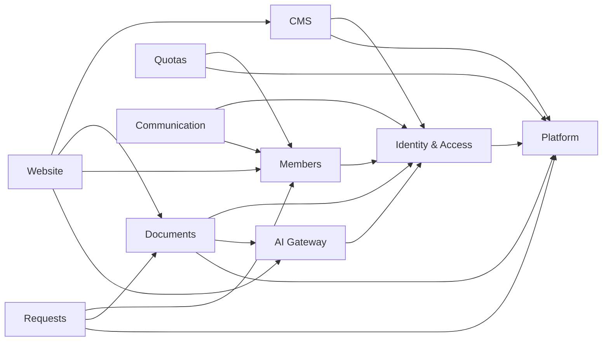
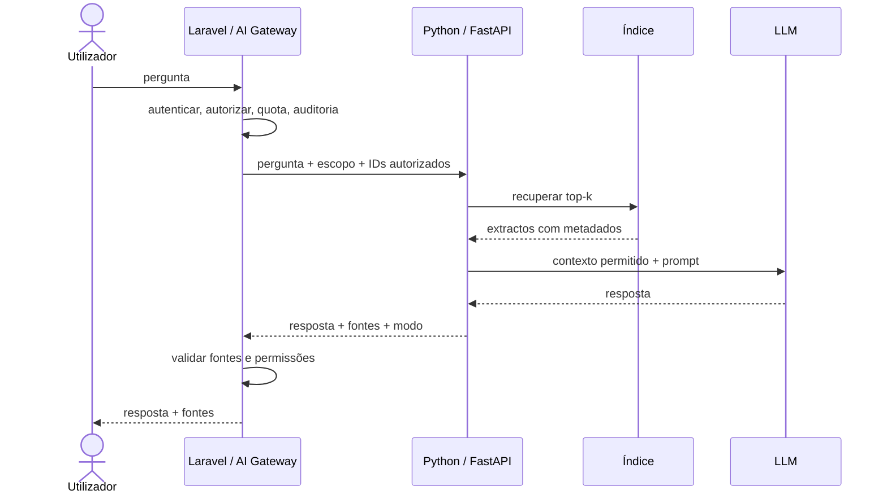

# Fase 1 — 01. Arquitectura da Plataforma

> **Estado:** rascunho para revisão.
> **Fase:** 1 — Arquitectura e modelação.
> **Depende:** Fase 0 aprovada em 12/11/2026 (`APROVACAO-FASE-0.md`).
> **Relacionado:** [`ADR-0001`](ADR-0001-cda-digital-3.0.md),
> [`00-matriz-migracao.md`](00-matriz-migracao.md).
> **Regra:** este documento não autoriza instalar Laravel nem alterar `main`.

## 1. Objectivo e âmbito

Definir a arquitectura lógica e de contentores do **CDA Digital 3.0 —
Plataforma de Gestão Institucional**, de forma a que os documentos seguintes
possam detalhar dados, contratos, segurança, armazenamento, migração e testes
sem decisões estruturais em aberto.

**Dentro do âmbito:**

- módulos, responsabilidades e fronteiras;
- comunicação entre o núcleo Laravel e o serviço Python;
- propriedade dos dados e regras de não-duplicação;
- fluxos principais, da consulta pública à resposta com IA;
- implantação lógica e atributos de qualidade;
- critérios de aceitação da arquitectura.

**Fora do âmbito (documentos seguintes):**

| Tema | Documento |
|---|---|
| ERD, entidades, relações e índices | `02-modelo-dados.md` |
| Contratos Laravel ↔ Python | `03-contratos-api.md` |
| Papéis, permissões, sessões e auditoria detalhada | `04-seguranca-rbac.md` |
| Object storage, OCR, retenção e restauro | `05-armazenamento-documental.md` |
| Importação, checksums, ensaios e rollback | `06-plano-migracao-dados.md` |
| Matriz de testes e critérios de aprovação | `07-testes-aceitacao.md` |

## 2. Decisões estruturantes

| # | Decisão | Justificação | Consequência |
|---|---|---|---|
| A1 | **Monólito modular Laravel 13** | Uma equipa pequena, domínio institucional coeso e necessidade de transacções consistentes. Microsserviços introduziriam custo operacional sem benefício comprovado. | Módulos com fronteiras explícitas, não um Laravel “floresta” sem regras. |
| A2 | **PostgreSQL como fonte de verdade** | Integridade relacional, relatórios, auditoria e uma única fonte para metadados. | JSON/JS antigos passam a fontes de importação; nunca destinos. |
| A3 | **Blade + Tailwind no site público** | Alinhamento com o design actual, SEO, simplicidade e menos JavaScript. | Componentes reutilizáveis; sem SPA nesta fase. |
| A4 | **Filament na administração** | CRUD e painéis com produtividade, sujeito a validação de compatibilidade com Laravel 13. | A versão exacta é decidida na Fase 2; a arquitectura não depende dela. |
| A5 | **Python/FastAPI independente para IA** | OCR, indexação e RAG têm dependências e ciclos de vida próprios. | Serviço separado, autenticado e sem acesso directo à base de dados. |
| A6 | **Object storage para ficheiros** | PDFs e imagens não devem viver no Git nem no sistema de ficheiros efémero da aplicação. | Chaves estáveis, checksum e backup definidos em `05`. |
| A7 | **Website como módulo Laravel** | ADR-0001: não há site provisório nem segunda reconstrução. | A Fase 3 entrega páginas e CMS dentro da mesma plataforma. |
| A8 | **Auditoria desde a fundação** | Acções administrativas, aprovações, pagamentos e acessos precisam de rasto. | Audit log e eventos definidos antes dos módulos de negócio. |
| A9 | **Assíncrono por omissão em trabalhos pesados** | OCR, indexação, e-mails e importações não podem bloquear pedidos web. | Filas persistentes e idempotência desde a Fase 2. |
| A10 | **Produção no mesmo domínio público, com áreas distintas** | Experiência pública e administração separadas por autenticação e autorização, não por produtos diferentes. | Um origem canónico; `/admin` e API protegidos por políticas. |

## 3. Contexto do sistema (C4 nível 1)

**Fronteiras de confiança:**

- O browser fala apenas com o Laravel; o serviço Python não é exposto directamente
  à Internet.
- O Laravel autentica, autoriza, aplica quotas e audita.
- O Python recebe apenas o necessário para processar o pedido.
- O provedor LLM é externo e recebe apenas o contexto permitido pela política de
  IA; documentos privados não entram em pedidos públicos.

## 4. Contentores (C4 nível 2)

| Contentor | Responsabilidade | Notas |
|---|---|---|
| Reverse proxy | TLS, cabeçalhos, limite de pedidos, compressão | Nginx/Caddy ou equivalente; decisão de alojamento pendente |
| Laravel web | Website, CMS, área de membro, administração, API | Um único código-base; áreas separadas por rotas e políticas |
| Queue worker | OCR, indexação, e-mails, importações, exportações | Worker persistente com supervisor; filas por prioridade |
| Scheduler | Quotas anuais, lembretes, limpezas, relatórios | Tarefas idempotentes e auditáveis |
| PostgreSQL | Metadados, relações, auditoria, sessões/filas conforme decisão | Fonte de verdade; backups e PITR em `05` |
| Object storage | PDFs originais, imagens, derivados e texto OCR | Checksum e versionamento; nunca no Git |
| FastAPI | OCR, indexação, recuperação e geração | Sem acesso directo à base de dados institucional |
| Índice/artefactos | Índice BM25, embeddings e textos derivados | Reconstruível a partir do corpus autorizado |

## 5. Módulos Laravel

O núcleo é um **monólito modular**. Cada módulo tem namespace, migrations,
políticas e testes próprios. A comunicação entre módulos faz-se por contratos
(interfaces), eventos de domínio ou serviços públicos — nunca por escrita directa
nas tabelas de outro módulo.

| Módulo | Responsabilidade | Dados que possui | Depende de |
|---|---|---|---|
| **Website** | Páginas públicas, notícias, actividades, galeria, pesquisa, SEO | Conteúdo publicado e rotas | CMS, Documents, Members, AI Gateway |
| **CMS** | Páginas, menus, notícias, actividades, media, rascunhos e publicação | Conteúdo editorial, media, revisões | Identity, Platform |
| **Members** | Registo profissional, aprovação, perfil, delegações, directório | `members`, histórico de estados | Identity |
| **Quotas** | Exercícios, emissão, pagamentos, recibos e reconciliação | `quotas`, `payments`, `receipts` | Members, Identity |
| **Requests** | Requerimentos, tramitação, anexos e histórico | `requests`, `request_events` | Members, Documents, Communication |
| **Documents** | Metadados, upload, versões, publicação, OCR e acesso | `documents`, `document_files`, `ocr_jobs` | Identity, Platform, AI Gateway |
| **Communication** | Mensagens de contacto, notificações e templates | `messages`, `notifications` | Identity, Members |
| **Identity & Access** | Utilizadores, sessões, papéis, permissões e políticas | `users`, `roles`, `permissions`, `sessions` | Platform |
| **AI Gateway** | Fronteira com o serviço Python, quotas, validação de fontes | `ai_requests`, `ai_usage` | Identity, Platform |
| **Platform** | Configuração, auditoria, jobs, saúde, backups e integrações | `audit_log`, `settings`, `jobs` | — |

### 5.1 Regras de fronteira

1. Um módulo não lê nem escreve directamente nas tabelas de outro; usa o contrato
   público do proprietário.
2. Eventos de domínio são preferidos para efeitos secundários (notificação,
   indexação, auditoria).
3. O módulo **Documents** é o único proprietário dos metadados documentais.
4. O módulo **Members** é o único proprietário do registo profissional.
5. **Identity** é o único proprietário de contas, sessões e permissões.
6. **Website** não contém regras de negócio; consome casos de uso dos módulos.
7. **AI Gateway** é o único ponto que fala com o serviço Python.
8. **Platform** não implementa regras de negócio; fornece infraestrutura
   transversal.

### 5.2 Dependências permitidas

A direcção aponta para dependências estáveis. `Platform` e `Identity` não dependem
de módulos de negócio. `Members` não depende de `Communication`: a aprovação
emite um evento e a comunicação reage, evitando um ciclo.

O `AI Gateway` não depende de `Documents`. Recebe do chamador os IDs autorizados e
devolve fontes; a validação final de acesso continua no módulo chamador, que é o
proprietário do recurso.

## 6. Propriedade e circulação dos dados

| Domínio | Fonte de verdade | Derivados permitidos | Proibido |
|---|---|---|---|
| Metadados de membros | PostgreSQL — `members` | Directório público, CDA Verify | `membros.json` como destino; contas automáticas |
| Metadados documentais | PostgreSQL — `documents` | Listagens, pesquisa, índice | `documentos.json`/`dados.js` como destino; 58 registos adicionais |
| Ficheiros | Object storage | Miniaturas, texto OCR, chunks | Cópias soltas no Git ou no disco da aplicação |
| Conteúdo editorial | PostgreSQL — CMS | Cache de página, sitemap | HTML estático editado à mão |
| Contas e permissões | PostgreSQL — Identity | Sessões, tokens de serviço | `is_admin` ou listas em JSON |
| Índice de IA | Serviço Python | Cache de respostas | Índice como fonte original de conteúdo |
| Auditoria | PostgreSQL — `audit_log` | Relatórios, exportações | Registo editável ou apagável pelo operador |

**Regras obrigatórias:**

- Um documento = um registo. Os 58 curados são atributos editoriais dos mesmos
  266 registos.
- Um membro não é um utilizador. A conta e o papel são registos separados.
- O ficheiro original é imutável; correcções criam nova versão com checksum.
- Toda a escrita relevante produz evento de auditoria.
- O Python não escreve em `members`, `quotas`, `documents` ou `users`.

## 7. Fluxos principais

### 7.1 Página pública

1. O browser pede a página ao Laravel.
2. O módulo **Website** resolve a rota e obtém conteúdo publicado do **CMS**.
3. Conteúdo e listagens são cacheados com invalidação por publicação.
4. O Laravel devolve HTML renderizado no servidor, com metadados SEO.
5. Nenhum dado privado de membros é incluído no HTML ou em cache pública.

### 7.2 Autenticação de membro

1. O browser submete carteira/e-mail e senha com CSRF.
2. **Identity** valida credenciais, estado da conta e rate-limit.
3. A sessão é criada com cookie `HttpOnly`, `Secure` e `SameSite=Lax`.
4. A autorização é resolvida por papel/permissão, não pela existência do registo
   de membro.
5. Logout revoga a sessão no servidor; alterações de senha revogam as restantes.

### 7.3 Registo e aprovação de membro

1. O candidato submete dados e prova de carteira.
2. **Members** valida o formato e verifica duplicados.
3. O registo fica **pendente**; não cria conta automaticamente.
4. Um operador autorizado aprova ou rejeita, com motivo auditado.
5. A aprovação pode criar a conta e a quota do exercício, conforme regra aprovada.
6. A decisão notifica o candidato e fica no histórico.

### 7.4 Upload, OCR e publicação documental

1. O operador autorizado envia o PDF.
2. **Documents** valida extensão, MIME/magic bytes, tamanho e checksum; coloca o
   original em quarentena.
3. O original é guardado no object storage com chave estável.
4. Um job de OCR é enfileirado; o estado fica visível no painel.
5. O worker solicita ao **AI Gateway**, que chama o serviço Python com o ID e o
   escopo autorizado.
6. O texto OCR e os metadados derivados são associados ao documento.
7. O operador revê e publica; só então o documento aparece no Centro Documental.
8. A publicação invalida cache e reindexa o corpus autorizado.

### 7.5 Quota, pagamento e reconciliação

1. **Quotas** gera a quota anual com referência única.
2. O membro consulta o estado e a referência de pagamento.
3. O operador registra o pagamento e a prova recebida.
4. Um segundo perfil confirma a reconciliação, conforme segregação de funções.
5. O recibo é emitido com numeração própria; anulações são auditadas.
6. Pagamentos parciais, duplicados e em atraso têm estados explícitos.

O gateway online, multas automáticas e suspensão automática continuam fora de
âmbito até decisão institucional.

### 7.6 Pergunta ao assistente (RAG)

Se o LLM não estiver disponível, o serviço devolve modo `local` ou
`sem-resultados`, nunca uma resposta inventada sem fontes.

## 8. Fronteira Laravel ↔ Python

| Aspecto | Decisão |
|---|---|
| Direcção | Laravel é cliente; Python é serviço. Nenhum acesso directo do browser ao Python. |
| Autenticação | Token de serviço de curta duração com `iss`, `aud`, `exp`, `jti` e escopos; mTLS/rede privada se disponível. |
| Autorização | O Laravel envia apenas IDs de documentos autorizados e o contexto mínimo. |
| Dados proibidos | Senhas, cookies de sessão, chaves de administração, PII desnecessária e acesso directo à base de dados. |
| Operações síncronas | Pergunta/resposta e pesquisa, com timeout e limite de payload. |
| Operações assíncronas | OCR e indexação por job, com idempotência e callback assinado. |
| Resposta | Resposta, modo, fontes, uso e `trace_id`; sem fontes fora do escopo. |
| Falhas | Erros tipados, retry com limite e circuit breaker; o Laravel degrada para fallback local. |
| Auditoria | Cada pedido e cada job ficam registados no Laravel. |

O contrato exacto, payloads, códigos de erro e quotas ficam em
`03-contratos-api.md`.

## 9. Segurança, privacidade e auditoria

**Planos de acesso:**

| Plano | Quem | Autenticação | Autorização |
|---|---|---|---|
| Público | Visitante | Não | Apenas conteúdo publicado |
| Membro | Membro com conta | Sessão | Próprios dados, quotas e requerimentos |
| Operador | Funcionário | Sessão + papel | Tarefas operacionais limitadas |
| Administrador | Gestor de domínio | Sessão + papel | Gestão do domínio, sem configuração crítica |
| Superadministrador | Responsável técnico | Sessão + 2FA | Configuração, permissões e operações sensíveis |

**Regras transversais:**

- Menor privilégio e segregação de funções.
- CSRF, rate-limit, protecção contra força bruta e revogação de sessão.
- 2FA para administração e superadministração, a validar em `04`.
- Minimização de PII no directório e no CDA Verify.
- Audit log imutável para autenticação, aprovação, publicação, pagamento,
  permissões e acesso a documentos privados.
- Segredos apenas no servidor/gestor de segredos; nunca no browser ou no Git.

O detalhe fica em `04-seguranca-rbac.md`.

## 10. Armazenamento documental

- Original imutável, com checksum e chave opaca.
- Quarentena antes da validação e da publicação.
- Derivados (texto OCR, miniaturas, chunks) separados do original.
- Metadados no PostgreSQL; ficheiros no object storage.
- Ciclo de vida: upload → quarentena → validado → publicado → retido/arquivado.
- Retenção, eliminação, backup e teste de restauro definidos em `05`.
- Nenhum PDF é apagado sem decisão registada e substituição documentada.

## 11. Implantação e operação

| Ambiente | Objectivo | Dados | Estado |
|---|---|---|---|
| Local | Desenvolvimento e testes | Fixtures e cópia autorizada | PostgreSQL local validado |
| Staging | Ensaio de migração e aceitação | Cópia anonimizada ou autorizada | A criar |
| Produção | Serviço oficial | Dados reais | Alojamento por decidir |

**Topologia de produção (proposta):**

- reverse proxy com TLS e cabeçalhos de segurança;
- PHP-FPM com Laravel;
- worker persistente para filas;
- scheduler;
- PostgreSQL gerido ou VPS com backup/PITR;
- object storage compatível com S3 ou disco gerido com snapshot;
- serviço Python em rede privada, sem exposição pública;
- logs, métricas, alertas e backup externo.

A escolha de alojamento, domínio e subdomínio continua pendente (secção 13 da
matriz). O Docker não é requisito.

## 12. Atributos de qualidade

| Atributo | Objectivo proposto | Como validar |
|---|---|---|
| Segurança | Nenhum acesso sem autorização; segredos fora do browser | Testes negativos, revisão e scan de dependências |
| Privacidade | Apenas campos necessários no directório/verify | Revisão de campos e testes de exposição |
| Disponibilidade | Serviço público disponível em horário institucional | Monitorização e ensaio de falha |
| Desempenho | Páginas públicas rápidas; pesquisa com latência controlada | Testes de carga e orçamento de latência |
| Integridade | Uma fonte de verdade por domínio | Contagens, checksums e constraints |
| Manutenibilidade | Fronteiras de módulo respeitadas | Revisão de dependências e testes por módulo |
| Observabilidade | Pedidos, jobs e erros rastreáveis | Logs estruturados, métricas e `trace_id` |
| Acessibilidade | Website navegável por teclado e leitor de ecrã | Testes automatizados e revisão manual |
| SEO | URLs estáveis, metadados e sitemap | Auditoria e testes de rotas |
| Recuperação | Restauro testado e documentado | Ensaio periódico com RPO/RTO |

Os valores numéricos de latência, disponibilidade e RPO/RTO serão fixados com a
CDA/GigaSystems antes da produção.

## 13. Riscos arquitectónicos

| Risco | Impacto | Mitigação |
|---|---|---|
| Erosão do monólito modular | Acoplamento e regressões | Contratos, revisão de dependências, testes por módulo |
| Serviço Python com acesso excessivo | Fuga de dados e privilégios | Token de escopo mínimo, sem BD, validação no Laravel |
| Duplicação de documentos ou membros | Contagens erradas e conflitos | Fonte única, chaves únicas, importação idempotente |
| Identidade membro/utilizador confundida | Permissões indevidas | Separação de tabelas e papéis explícitos |
| OCR incompleto | RAG sem cobertura | Gate G5 e relatório por documento |
| Alojamento indefinido | Bloqueio da Fase 2 | Decisão CDA/GigaSystems antes da fundação |
| Backups apenas locais | Perda de dados | Cópia externa, PITR e teste de restauro |
| Website tratado como produto separado | Segunda reconstrução | ADR-0001 e critério da Fase 3 |

## 14. Critérios de aceitação da arquitectura

1. Todos os módulos da matriz têm responsabilidade e proprietário de dados.
2. As dependências entre módulos são acíclicas e documentadas.
3. Os fluxos públicos, de membro, documentais, financeiros e de IA estão cobertos.
4. A fronteira Laravel ↔ Python não permite acesso directo à base de dados.
5. O website é um módulo Laravel, sem solução provisória.
6. A implantação proposta cobre web, worker, scheduler, PostgreSQL, storage e IA.
7. Riscos e questões abertas têm responsável ou documento de destino.
8. `02`–`07` podem ser escritos sem reabrir decisões estruturantes.

## 15. Questões abertas

| # | Questão | Documento de decisão |
|---|---|---|
| 1 | Alojamento, domínio e subdomínio | Fase 2 / CDA + GigaSystems |
| 2 | Object storage vs. disco gerido | `05-armazenamento-documental.md` |
| 3 | Driver de filas e cache | `02-modelo-dados.md` / Fase 2 |
| 4 | Pesquisa: PostgreSQL FTS vs. motor dedicado | `02-modelo-dados.md` |
| 5 | Política de retenção e eliminação | `05-armazenamento-documental.md` |
| 6 | 2FA obrigatório para que papéis | `04-seguranca-rbac.md` |
| 7 | Provedor LLM e limites de custo | `03-contratos-api.md` |
| 8 | Nível de anonimização do staging | `06-plano-migracao-dados.md` |

## 16. Próximos documentos

| Ordem | Documento | Depende de |
|---|---|---|
| 1 | `02-modelo-dados.md` | Módulos e propriedade de dados deste documento |
| 2 | `03-contratos-api.md` | Fronteira Laravel ↔ Python |
| 3 | `04-seguranca-rbac.md` | Planos de acesso e módulos |
| 4 | `05-armazenamento-documental.md` | Fluxo documental e contentores |
| 5 | `06-plano-migracao-dados.md` | Modelo de dados e armazenamento |
| 6 | `07-testes-aceitacao.md` | Todos os anteriores |

A aprovação deste documento não autoriza a instalação Laravel. A Fase 2 continua
bloqueada até a Fase 1 estar concluída e o alojamento, domínio e âmbito
institucional estarem decididos.
